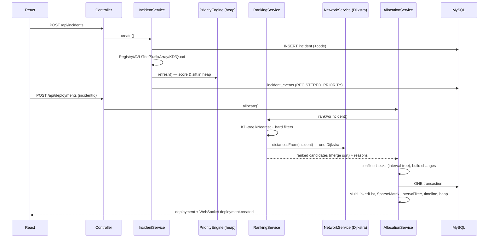

# NEXA architecture

## Layers (spec §2.2)

| Layer | Location | Responsibility |
|---|---|---|
| Controllers | `backend/include/controllers`, `src/controllers` | HTTP/WS routing, JSON ↔ domain mapping, authentication, NexaError → HTTP status |
| Services | `include/services`, `src/services` | workflows and business rules; the only code that mutates state |
| Data-structure engine | `include/data_structures` | 27 hand-written containers (no STL container substitutes) |
| Algorithm engine | `include/algorithms` | sorting, searching, graph, backtracking, instrumented with `OpCounter` |
| Repositories | `include/repositories`, `src/repositories` | all SQL; transactions for multi-record writes |
| Models | `include/models` | plain domain types |
| Utilities | `include/utilities` | geo, validation, errors, SHA-256, CSV, TXT logger |

The engine and services do **not** depend on Drogon, so they compile and are tested on any machine (`NEXA_BUILD_SERVER=OFF`).

## Consistency between MySQL and memory (spec rule 10)

`OperationalStore` (services/Store.hpp) holds every in-memory index. MySQL is the source of truth:

1. On start-up `NexaCore::bootstrap()` rebuilds all structures from the repositories (taxonomy → road graph → resources → hospitals → incidents → timelines → deployments → spatial bulk build → priorities → request queues → users).
2. Every command validates first, **writes to the repository**, and only after a successful write updates the in-memory structures. If a write throws, memory is untouched.
3. Allocation and release call one repository method that runs inside a single DB transaction (deployment rows, deployment_resources, resource availability, availability log, incident events, request status). The MySQL implementation waits for the COMMIT result; the integration test `Workflow.AllocationIsTransactional` simulates a failing commit and checks nothing changed.
4. A coarse recursive mutex serialises access to the store (simple and correct for this workload).
5. `POST /api/system/reload` rebuilds everything from the database on demand.

## End-to-end workflow (spec §5)

## Spatial design note

Lat/lon points are mapped to 3-D unit vectors. Euclidean (chord) distance is monotonic in great-circle distance, so the 3-D KD-tree returns exact Haversine nearest neighbours, and axis-plane distances are valid pruning bounds. Region (rectangle) queries use the Quad-tree (lat/lon space) or the static Range tree.

## Concurrency & live updates

Drogon runs 4 I/O threads; every service method locks `store.mtx`. Services publish `LiveEvent`s through `IEventSink`; `LiveBroadcaster` serialises them to JSON and sends them to all WebSocket connections (kept in the custom linked list). The frontend debounces bursts and refreshes the affected views silently.
